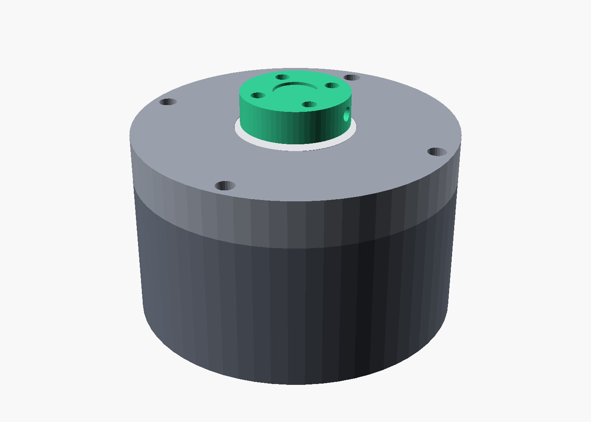
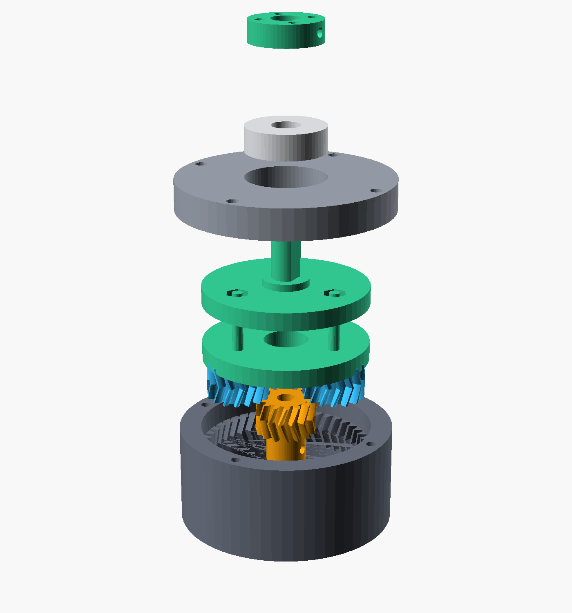

# planet17

A parametric, 3D-printable planetary gearbox for NEMA 17 steppers. 4:1 or 5:1 out of the box, any ratio you can build from a tooth count, and CI checks the gears do not collide at a dozen sun angles before you waste filament.



Nothing in this repository has been printed or run on a motor. Everything below was verified in simulation: watertight meshes, a collision sweep across sun angles, and negative controls that show the check can fail. See [what is not verified](#what-is-not-verified).

## Get the parts

Download `planet17-r4.zip` or `planet17-r5.zip` from the [releases page](../../releases) and print the seven parts. Or use the STLs in [`stl/`](stl/).

| | r4 (default) | r5 |
|---|---|---|
| Ratio | 4:1 | 5:1 |
| Teeth sun / planet / ring | 15 / 15 / 45 | 16 / 24 / 64 |
| Planets | 3 | 4 |
| Module, helix, width | 1.0 mm, 20 deg herringbone, 10 mm | same |
| Housing diameter x length | 59.5 x 27 mm (plus 8.5 mm cover and 7 mm output flange) | 78.5 x 27 mm |
| Filament, solid | 99 g PLA | 180 g PLA |

Hardware per box: one 608 bearing, M3 screws and nuts. Full list in [docs/BOM.md](docs/BOM.md), steps in [docs/ASSEMBLY.md](docs/ASSEMBLY.md).



## Change the ratio

Open `scad/planet17.scad` in OpenSCAD, pick a preset in the Customizer, or edit three numbers:

```
ring_teeth   = sun_teeth + 2 * planet_teeth
ratio        = 1 + ring_teeth / sun_teeth
(sun_teeth + ring_teeth) / planets must be a whole number
```

The file asserts both rules and stops with a message if you break one. From a shell:

```sh
openscad -p presets/planet17.json -P r5 -D 'part="housing"' -o housing.stl scad/planet17.scad
```

`part` is one of `assembly`, `exploded`, `section`, `housing`, `cover`, `sun`, `planet`, `carrier_rear`, `carrier_front`, `flange`. Tooth count limits and what to watch for are in [docs/DESIGN.md](docs/DESIGN.md).

## What the CI checks

`scripts/check.sh` needs OpenSCAD (a 2025+ build with the Manifold backend) and Node 18+, no npm packages.

```
$ scripts/check.sh r4
ok   stl/r4/housing.stl  tris=52740 vol=34906.6 mm3 size=59.5 x 59.5 x 27.0 open_edges=0
...
clash sweep: 12 angles, worst overlap 0 mm3
negative control, wrong helix hand: 111.205 mm3 (must be > 0)
negative control, 6 deg phase error: 127.463 mm3 (must be > 0)
all checks passed
```

1. Every part exports as a closed mesh: each edge shared by exactly two triangles, positive volume.
2. The whole gearbox (sun, planets, ring housing, both carrier plates, cover, output flange) is posed at 12 sun angles and every pair of parts is intersected. The planets and carrier move with the real kinematics, so the sweep also fails if the ratio maths is wrong. Result for both presets: 0 mm3 overlap.
3. The same test with a planet helix of the wrong hand, or with the planets one-sixth of a tooth out of phase, reports 111 to 388 mm3 of overlap. A check that cannot fail is worthless, so CI requires this.

With `backlash = 0.25` (the default, a print tolerance) there is 0 overlap. The r4 geometry stays clash-free down to 0.05 mm backlash and shows 0.04 mm3 at zero.

## What is not verified

- No part has been printed. The 0.25 mm backlash, 0.2 mm fits and 0.5 mm axial gaps are typical values for a 0.4 mm nozzle, not tuned ones. Expect to adjust `backlash` and `fit` for your printer.
- Torque, efficiency, noise and wear are unmeasured. The load limit will be the plastic teeth, not the motor.
- The shaft is assumed to be a 24 mm long, 5 mm D shaft measured from the motor face. The sun grips about 18.6 mm of it and needs the shaft to reach 21 mm.
- Housing is wider than the motor (59.5 mm against 42.3 mm for r4). That is what a ring of 45 module-1 teeth costs.
- Pins are M3 screws running in the printed planet bores, no bearings. Fine for light loads, wears faster than needles or bushings.
- 4:1 and 5:1 are the only ratios tested. Other tooth sets pass the same checks when you run them, but the presets are what CI covers.

## Layout

```
scad/gear.scad        involute + herringbone gears, no dependencies
scad/planet17.scad    parts, assembly, clash test
presets/              Customizer parameter sets
scripts/              build.sh, check.sh, stlcheck.mjs
stl/                  generated, committed so you can download single files
docs/                 assembly, parts list, design notes
```

## Contributing

Print results are the most useful contribution: your printer, settings, backlash that worked, and photos. See [CONTRIBUTING.md](CONTRIBUTING.md).

## License

CERN-OHL-P-2.0 (permissive). See [LICENSE](LICENSE).
